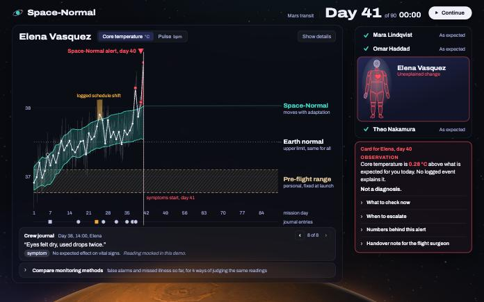

<div align="center">

# Space-Normal

**Health monitoring for astronauts that knows how a body is *expected* to change in space, and raises an alarm only on what that cannot explain.**



<br>


**[▶ Open the live dashboard](https://spacenormal.vercel.app)**

</div>

> **The alarm is never raised by a language model.** Severity comes from a transparent statistic that runs offline. A model may only phrase the sentence, and every number it writes is checked against the data first.

---

## Demo

**[spacenormal.vercel.app](https://spacenormal.vercel.app)** — a 90-day mission replays in about 13 seconds and stops the moment Space-Normal raises an alert.

Watch the three bands on the chart. `Earth normal` and `Pre-flight range` are flat, and both collect false alarms as the crew adapts. The Space-Normal corridor bends with the mission and stays quiet until illness actually starts. Click any point for that day's breakdown, or press `D` for the details view. `?day=40` opens a specific day.

The replayed mission is synthetic and labelled as such. It illustrates the idea; it is not a result.

---

## The problem

A healthy astronaut does not stay inside clinical reference ranges.

After about two and a half months in orbit, resting core temperature rises by roughly 1 °C and can approach **38 °C** ([Stahn et al. 2017](https://doi.org/10.1038/s41598-017-15560-w), 11 astronauts [[1]](#sources)). After landing, **5 of 13** astronauts met the WHO criteria for anemia ([Trudel et al. 2022](https://pmc.ncbi.nlm.nih.gov/articles/PMC8799460/) [[2]](#sources)). Blood pressure drops, cardiac output rises by about **41 %**, and resting pulse barely moves (Norsk et al. 2015, 8 astronauts [[3]](#sources)). None of it is illness.

So a monitor built on hospital thresholds fails in both directions. It fires on healthy adaptation, and it stays quiet while a real change hides inside a range that is simply wrong for this person on this day.

On a Mars transit that stops being an annoyance and becomes a safety gap. A message takes up to **22 minutes** one way, the link can go silent for around **two weeks** near solar conjunction, there is no evacuation, and NASA-STD-3001 does not require a physician on board. The crew makes the first call itself.

## The solution

Three ways to decide whether a reading is normal. Only one of them moves.

| Approach | What "normal" means | What goes wrong |
|---|---|---|
| **Earth normal** | One clinical threshold for everyone | Fires on healthy adaptation, misses changes that stay inside the range |
| **Pre-flight range** | This person's own range from before launch (NASA's CDSS concept, HRP-48033) | Personal, but flat — it never accounts for the mission itself |
| **Space-Normal corridor** | Where *this person* is expected to be on *this mission day* | — |

The corridor is built from four parts, and the detector only ever looks at what is left over:

1. the person's own pre-flight baseline,
2. the adaptation expected on that mission day, scaled to how strongly this person adapts,
3. the logged events of the day — the workout, the shifted sleep schedule, the cabin CO₂,
4. the spread that is normal between people.

Measurement minus expectation is the **residual**. A CUSUM accumulates small, persistent deviations in the residual into an amber or red alert, so a hard training session is *explained* rather than alarmed. A crew layer raises a separate alert when several crew members drift together and no logged event accounts for it.

Think of a growth chart at the pediatrician: a child is compared to where that child should be at that age, not to the average adult. Same idea, with mission day in place of age.

## What each user gets

| User | What they see |
|---|---|
| **The astronaut** | Three lines each morning — OBSERVATION (what we see, in their own numbers), CHECK NOW (a one-minute action), ESCALATE IF (the condition that sends it further). Always ends with "Not a diagnosis." |
| **The Crew Medical Officer** | A crew member with short medical training, not a physician: the whole crew at a glance, plus the outbreak layer |
| **The flight surgeon on Earth** | A small queued packet, and only when someone actually leaves their corridor |

## How it works


| Module | Responsibility |
|---|---|
| `src/spacenormal/data/` | NASA bed rest loader (with the test-set lock), Stanford illness signatures, synthetic generator |
| `src/spacenormal/model/` | Baseline + adaptation × personal scale + logged events → residual |
| `src/spacenormal/detect/` | CUSUM per person, crew layer for an outbreak |
| `src/spacenormal/baselines.py` | The two competitors: Earth normal and the pre-flight range, plus rolling recalibration |
| `src/spacenormal/llm/` | Templated note with number verification, fixed checklists — never part of the alarm decision |
| `src/spacenormal/pipeline.py` | Mission → the JSON contract the dashboard reads |
| `web/` | React dashboard; `web/src/contract.ts` is the contract, mirrored in `contract.py` |

## The data

| Set | Subjects | Use |
|---|---|---|
| NASA bed rest, Campaign 1 + Campaign 3 blocks A/C/D/E | 18 | Fit priors, event coefficients, thresholds |
| CFT70 (Campaign 11) | 3 | Held-out test, one crew of 3 |
| Campaign 3 blocks G + H | 8 | Second held-out test, two crews of 4 |

Bed rest — weeks of lying with the head tilted 6° down — is how NASA simulates weightlessness on the ground. Illness signatures come from Stanford's COVID-19 wearable study [[4]](#sources).

**The held-out set is locked in code.** `src/spacenormal/data/nlsp.py` raises `TestSetLocked` for CFT70 and blocks G/H until `docs/claims.md` contains a configuration hash, which only the evaluation step writes. Tuning on the test set is not a matter of discipline here — the loader refuses.

## Getting started

```bash
make setup            # Python 3.11 venv via uv, installs the package
make test             # pytest + hypothesis
make demo-synthetic   # synthetic missions -> model -> detectors -> web/public/cache/*.json
```

```bash
cd web && npm install && npm run dev
```

The dashboard is a static Vite build (`npm run build` writes `web/dist/`), so any static host will serve it. Raw data is never committed; `data/manifests/` records what was fetched. The presentation deck is a single offline file: `open deck/index.html`.

Project documentation lives in [`docs/`](docs/) (Polish); the technical specification is [`PLAN.md`](PLAN.md) (English).

## Honesty

Bed rest is a ground analog, not spaceflight. Illness signatures come from Earth wearable data. The flight-like scenarios in the demo are synthetic, sized from published flight findings and labelled `SYNTHETIC`.

The evaluation on the held-out NASA data is the next step, so this repository carries **no accuracy numbers** — `docs/claims.md` is still a stub, and nothing here is validated on astronaut data. This is decision support, not diagnosis.

Personal baselines are not new: Baevsky's prenosological work at IBMP, NASA's own CDSS concept with pre-flight reference ranges, and Scott et al. 2023 ("the best baseline for an individual is oneself"). What is new here is a corridor that bends with the phase of the mission, and that it sits one question earlier than NASA's CMO-DA assistant: not *what is wrong with me*, but *is this still normal — for me, today?*

## Sources

1. A. Stahn et al., *Increased core body temperature in astronauts during long-duration space flights*, Sci Rep 2017: [doi:10.1038/s41598-017-15560-w](https://doi.org/10.1038/s41598-017-15560-w). Source of the ~1 °C rise and the approach toward 38 °C.
2. G. Trudel et al., *Hemolysis contributes to anemia during long-duration space flight*, Nat Med 2022: [PMC8799460](https://pmc.ncbi.nlm.nih.gov/articles/PMC8799460/). Source of 5 of 13 astronauts meeting WHO anemia criteria after landing.
3. P. Norsk et al., *Fluid shifts, vasodilatation and ambulatory blood pressure reduction during long duration spaceflight*, J Physiol 2015, 593:573. Source of the blood-pressure drop, the +41 % cardiac output and the unchanged resting pulse.
4. T. Mishra et al., *Pre-symptomatic detection of COVID-19 from smartwatch data*, Nat Biomed Eng 2020. Source of the illness signatures transplanted into the residuals.
5. NASA Life Sciences Portal — bed rest campaigns: [nlsp.nasa.gov](https://nlsp.nasa.gov). Source of all real subject data used here.

Communication delays and the medical-system requirements are cited in [`docs/02-dowody-nasa.md`](docs/02-dowody-nasa.md), with the NASA documents behind each claim.

## Team

Built at **NASA Space Apps Challenge 2026** by team **Beszketnyky**, for the challenge *Create Health Monitoring Software for Astronauts on Space Missions*.

No NASA endorsement is implied. The Mars image behind the dashboard is "Global Color Views of Mars" (PIA00407), a Viking Orbiter mosaic, credit NASA/JPL/USGS. Typeface: Archivo (SIL Open Font License).
